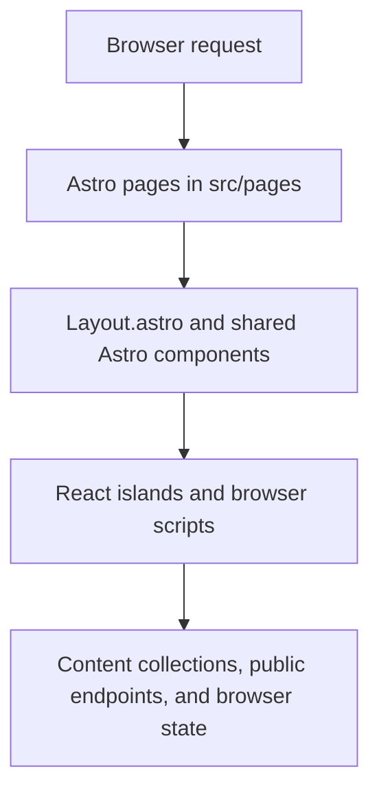

# Cueory architecture

This is a code-derived map of the current site. It describes the paths used by the published pages and browser interactions. It does not define new product behavior.

## Request and runtime flow

Astro renders each file under `src/pages/` into a route. Most pages use `src/layouts/Layout.astro`, which supplies the document head, skip link, shared header and footer, main region, optional promo panel, and the offline registration hook. Shared non-interactive page structure lives in `src/components/`.

Interactive work is isolated in React components under `src/islands/` and in browser scripts under `src/scripts/`. Astro pages choose how an island runs, such as `client:only="react"` for a browser-only game or study surface. Pages also include a readable fallback or `noscript` path where the source provides one.

## Page groups

| Page group | Entry points | Main responsibility |
| --- | --- | --- |
| Marketing and site shell | `src/pages/index.astro`, `support.astro`, `privacy.astro`, `terms.astro`, `disclaimer.astro`, `404.astro` | Publish the home, support, policy, and not-found pages through the shared layout. |
| Course library and lesson modes | `src/pages/learn/index.astro` and `src/pages/learn/study-skills/*.astro` | Render the course outline and the cards, learn, fill-in, matching, organizer, questions, and label-it study surfaces. |
| Daily games | `src/pages/play.astro` | Load sample puzzle collections, validate game inputs, and mount the four game islands. |
| Account and utility routes | `src/pages/start.astro`, `signin.astro`, `signup.astro`, `progress.astro`, `reset-password.astro`, `subscribed.astro`, and `admin/flags.astro` | Provide account, progress, subscription-result, and admin entry points. Their related auth, account, database, and admin modules have separate ownership boundaries in the repository instructions. |
| Preview and generated routes | `src/pages/preview/*.astro`, `src/pages/sitemap.xml.ts`, `src/pages/sw.js.ts`, and `register-sw.js.ts` | Expose preview fixtures, the sitemap, and the service-worker build outputs. |

The public sitemap is intentionally maintained as a separate list in `src/config/routes.ts`. Preview and noindex routes are kept out of that list.

## Data flow

### Build time

- JSON files under `content/` are loaded as Astro content collections.
- `src/content.config.ts` defines the collection schemas and rejects malformed entries during the build.
- Page files call collection helpers such as `getEntry` and `getCollection`, then pass the validated public data into markup or an island.
- Configuration shared by pages and components comes from `src/config/`, including site settings, routes, study modes, and games.

### In the browser

- Theme selection uses `src/scripts/theme.ts` and the `ThemePicker.astro` component. A saved Light or Dark choice is read from browser storage before paint. Device mode removes the saved override.
- Menu, header, footer, promo, progress, and offline behavior are implemented by focused files in `src/scripts/`. The offline registration script starts the service worker only in the built site when the configuration enables it.
- Study and game islands keep their interaction state in React and their tested pure helpers. Progress and stars use the browser storage helpers in `src/scripts/progress.ts` and `src/scripts/storage.ts`.
- Sample question pages expose only public sample fields. The question logic separates public question data from checker results, and protected account or study-data paths remain in their designated modules.

## Where to look first

- Route composition: `src/pages/` and `src/layouts/Layout.astro`
- Shared markup: `src/components/`
- Interactive UI: `src/islands/*.tsx`
- Browser behavior and storage: `src/scripts/`
- Build-time content and validation: `content/` and `src/content.config.ts`
- Site configuration: `src/config/`
- Unit and browser coverage: `tests/unit/` and `tests/e2e/`

Update this document when the architecture changes. Keep descriptions grounded in the referenced source files and avoid placing private content or credentials in the repository.
